# 🍕 Pizza Ordering & Inventory Management System (MERN Stack)

This is a full-stack pizza delivery application built using the **MERN Stack** (MongoDB, Express.js, React.js, Node.js). It allows users to customize and order pizzas while providing an admin panel to manage inventory, users, pizzas, and orders.

---

## 🔗 Live Demo

> 🚀 Deployed at: [Client Side](https://pds-client-gamma.vercel.app/)
      [Admin Panel](https://pds-admin-ten.vercel.app/)

---
## 📸 SnapShots

### 🔐 AUTH

-  — User login screen
-  — User registration/signup form
-  — Forgot password page with OTP request
-  — Reset password using OTP screen
-  — Password reset confirmation screen
-  — Admin signup screen(Requires Admin Secret Key To signup)
-  — OTP received in email inbox (MailTrap)

### 🧑‍💼 ADMIN

- 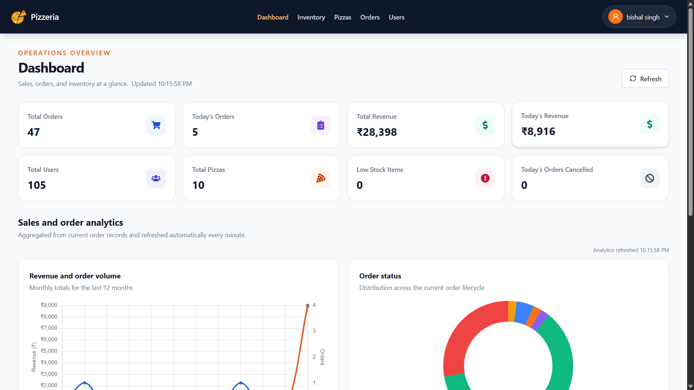 — Admin dashboard with KPIs and charts
-  — Revenue and order analytics graph
-  — Form to create new pizza option
-  — Form to update existing pizza
- 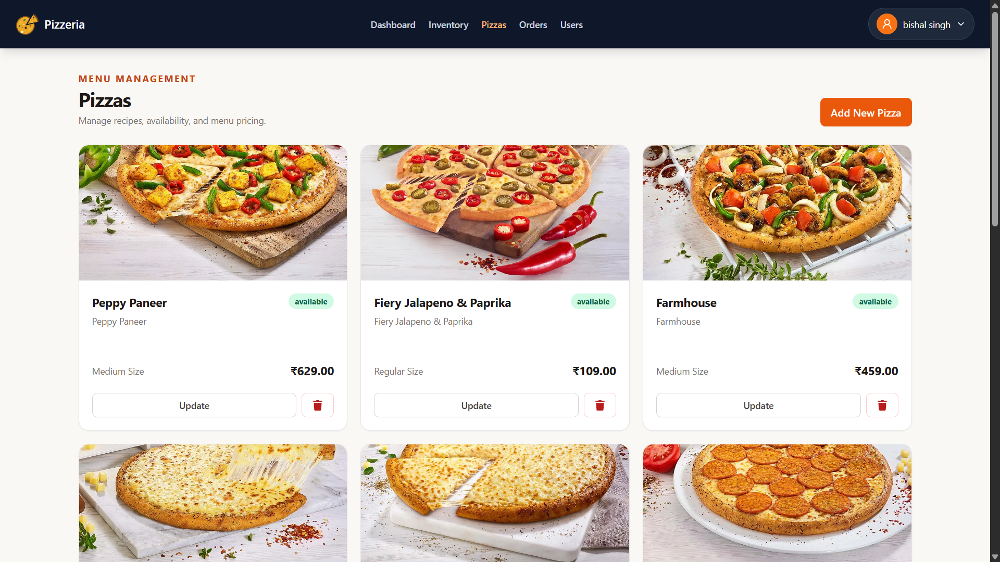 — List of all available pizzas
-  — Confirm pizza delete modal
- 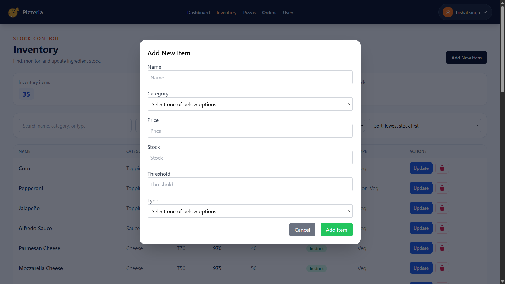 — Add new inventory item to stock
- 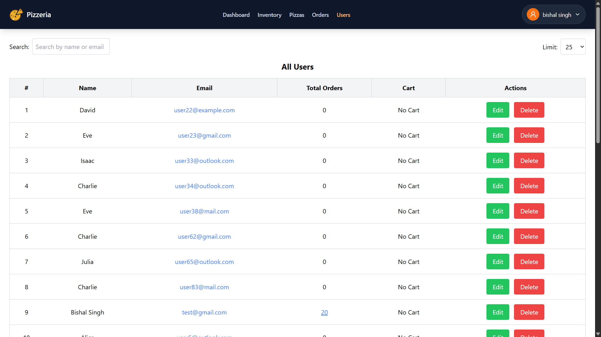 — View all registered users
-  — Admin can edit user details
-  — Search user by name or email
- 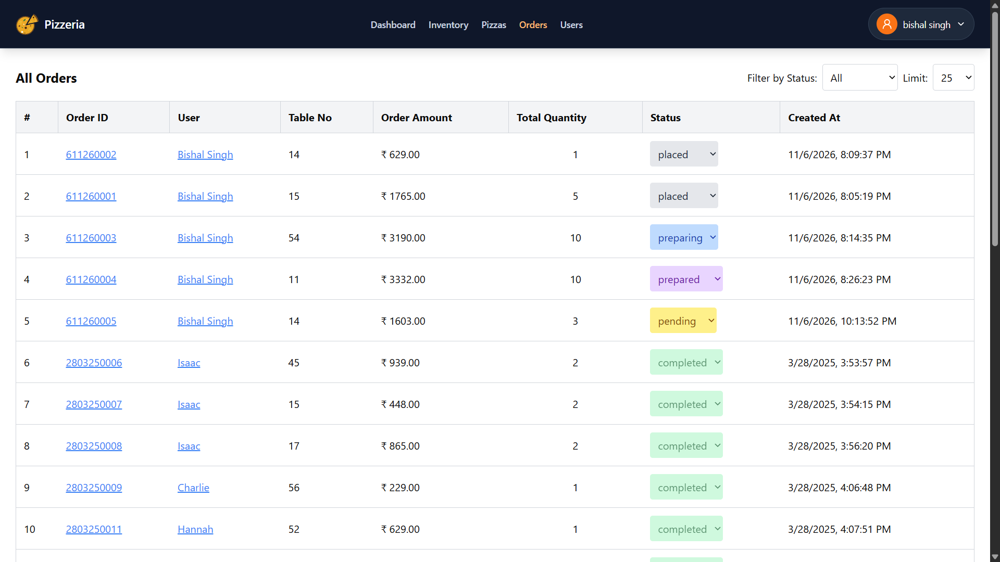 — All user orders for review
-  — View detailed order with specific ID
-  — View specific user’s cart
-  — View list of orders placed by a user

### 🧑 USER

- 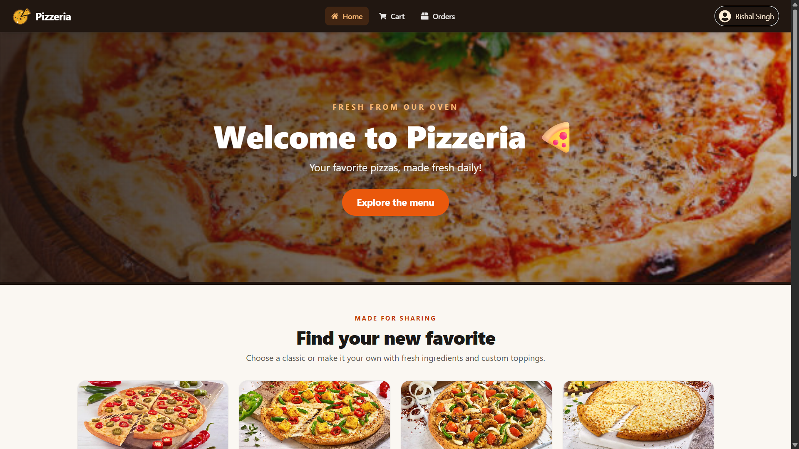 — Public landing page for users
- 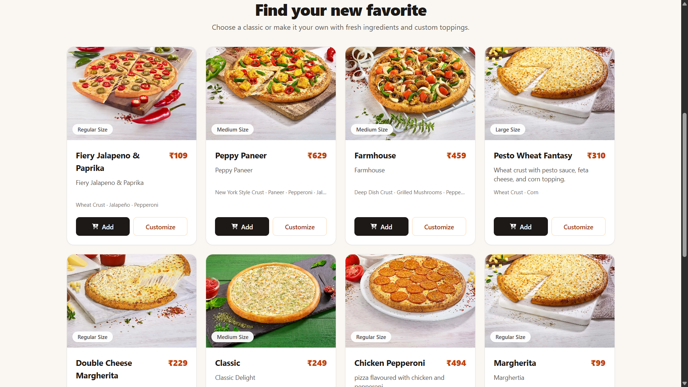 — Displaying all available pizzas
- 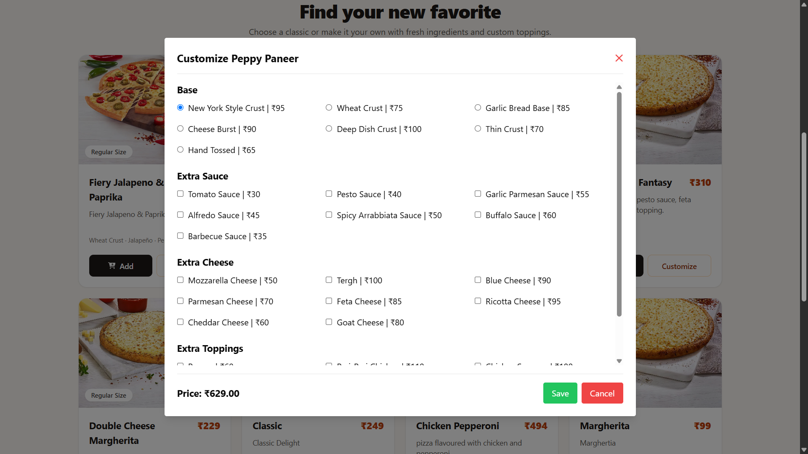 — User customizing pizza ingredients
- 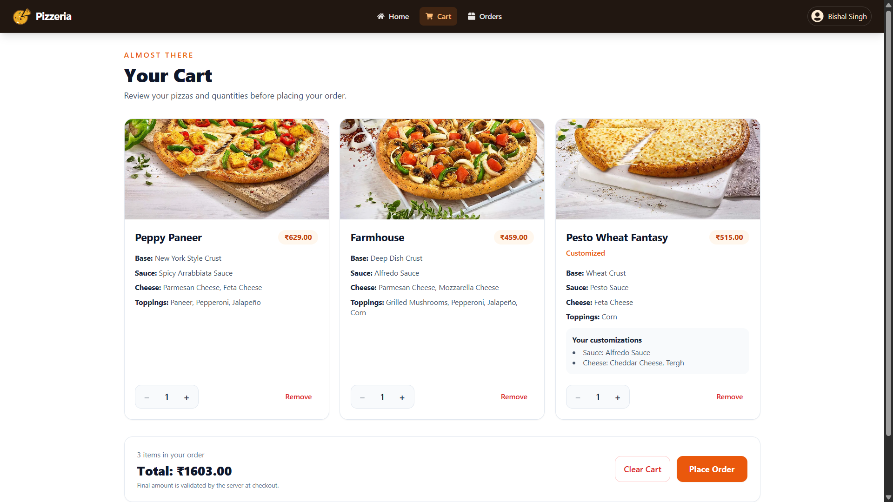 — User’s cart with pizzas and quantities
-  — Final confirmation before placing order
-  — Order cancelled after payment
-  — Cancelled before payment
- 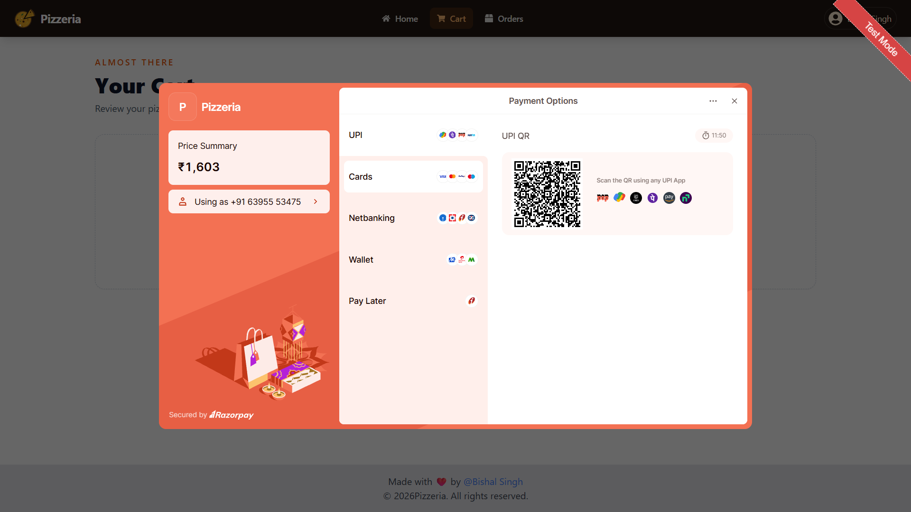 — Razorpay payment integration
-  — Razorpay payment success confirmation
- 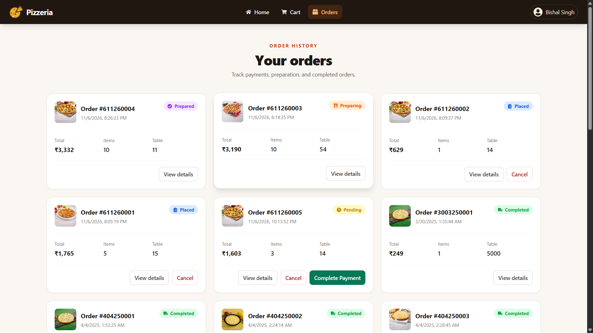 — Past orders with status and details


## ⚒️ Tech Stack

### **Frontend**

* React.js (with Tailwind CSS / Material UI)
* Axios
* React Router
* Zustand (for cart & user session)
* Razorpay (Payment Gateway)

### **Backend**

* Node.js
* Express.js
* MongoDB with Mongoose
* Nodemailer (for OTP-based password reset & email verification)
* JWT + Cookies for authentication/session

---

## 📂 Project Structure

```

/Admin           # React frontend for Admin Pages
/Client          # React frontend for Client(Users)
/Server          # Express backend
```

---

## ⚙️ Features

### 👨‍🍳 Admin Panel

* 🔧 Manage ingredients, baseType And Size  (create, update, delete, stock, threshold)
* 🍕 Manage pizzas (create,delete,update including customizing with size, crust, sauce, cheese, toppings,availability)
* 🛒 View & manage orders (update status: placed → Preparing → prepared → Completed | Cancelled)

* 📊 Analytics dashboard with:

  * Today's orders & revenue
  * Total orders, users, pizzas
  * Order status distribution pie chart
  * Revenue over time (line chart)
  * 🔔Low Stock Item Alert

### 👨‍🍽️ User Panel

* 🔐 Register/Login (reset with OTP verification)
* 🫐 Customize your pizza
* 🛍️ Add to cart & checkout
* 💳 Pay securely via Razorpay
* 📬 Track order status live

---

## 🍕 Some Demo Pizza Customization Options

* **Size**: Regular, Medium, Large, Extra Large, Monster
* **Base**: Thin crust, Hand-tossed, Cheese burst, 100% wheat, New York-style
* **Sauce**: Tomato, Alfredo, Pesto, BBQ, Spicy Arrabbiata
* **Cheese**: Mozzarella, Cheddar, Parmesan, Goat Cheese, Blue Cheese
* **Toppings**:

  * **Veg**: Paneer, Mushroom, Onion, Olive, Jalapeño, Tomato, Capsicum
  * **Non-Veg**: Chicken Tikka, Sausage, Pepperoni, Chicken Keema, BBQ Chicken

Pricing is dynamically calculated based on selected options(Effective on public page only).

---

## 🔐 Authentication

* Users register andusing thier email.
* Admin can register using thier email along with the admin secret key.
* Forgot password flow uses OTP verification to reset Password.
* Sessions are cookie-based with 3-day expiry.

---

## 📦 Inventory Management

* Stock decreases automatically upon order status update(Decreases on placed and increases on cancellation.)
* Threshold alerts trigger email to admin when stock is low

---

## 📊 Admin Analytics

* Total orders, users, pizzas
* Today's revenue & orders
* Pie chart for order status Distributions.
* Line chart for revenue trend over the time period.
* List of most valuable users by most order count.

---

## 🧪 How to Run Locally

### Clone the Repo

```bash
git clone https://github.com/bishal292/Pizza-Delivery-System.git
cd pizza-delivery-system
```

### Setup Backend

```bash
cd Server
npm install
cp .env.example .env     # Fill in Mongo URI, JWT secret, email credentials and other required details as guided in the .env.example
npm run dev
```

### Setup Frontend
#### Client

```bash
cd Client
npm install
cp .env.example .env    # Fill in required environment Variables as guided in the .env.example
npm run dev
```
#### Admin

```bash
cd Admin
npm install
cp .env.example .env     # Fill in required environment Variables as guided in the .env.example
npm run dev
```

---

## 👨‍💻 Author

**Bishal Singh**
[LinkedIn](https://linkedin.com/in/bishal-singh292/) | [GitHub](https://github.com/bishal292)

---

## 📍 License

[MIT License](./LICENCE)

---

## 💬 Feedback

Have suggestions or feature requests? Feel free to open issues or reach out!
