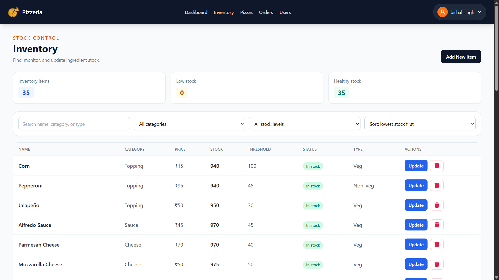

# Pizza Delivery System

A full-stack pizza ordering and inventory management application. Customers can
customize pizzas, place and track orders, and pay online. Administrators can
manage pizzas, ingredients, customers, and orders from a separate dashboard.

## Live demos

- [Customer application](https://pds-client-gamma.vercel.app/)
- [Admin dashboard](https://pds-admin-ten.vercel.app/)  while creating admin account use `1234` as secret code to create account

## Features

### Customer experience

- Browse available pizzas and customize size, crust, sauce, cheese, and toppings.
- Manage a cart and place orders with Razorpay checkout.
- View order history and follow order status updates in real time.
- Create an account, sign in, and reset a password using email OTP verification.

### Administration

- Create, update, and remove pizzas and inventory items.
- Search and filter inventory, with low-stock alerts.
- Review customers, carts, and orders; update order status.
- View dashboard metrics and revenue and order charts.

### Order and inventory handling

- Calculate order prices on the server using current pizza and ingredient prices.
- Reserve ingredient stock during checkout and restore eligible reservations on
  cancellation.
- Verify Razorpay payment details on the server before confirming paid orders.

## Technology

| Application | Main technologies |
| --- | --- |
| Customer app (`client/`) | React, Vite, Tailwind CSS, Zustand, Axios |
| Admin app (`Admin/`) | React, Vite, Tailwind CSS, Zustand, Axios, Chart.js |
| API (`Server/`) | Node.js, Express, MongoDB, Mongoose, Socket.IO |
| Integrations | Razorpay, Nodemailer |

The customer app, admin dashboard, and API are separate applications with
independent dependencies and environment configuration.

## Run locally

### Requirements

- Node.js and npm
- MongoDB (local or hosted)
- Razorpay credentials for payment features
- Email provider credentials for OTP and email notifications

### 1. Get the project

```bash
git clone https://github.com/bishal292/Pizza-Delivery-System.git
cd Pizza-Delivery-System
```

### 2. Configure and start the API

In a terminal:

```bash
cd Server
npm install
```

Copy `Server/.env.example` to `Server/.env` (for PowerShell, use
`Copy-Item .env.example .env`; for macOS/Linux, use `cp .env.example .env`).
Set the MongoDB URL, a unique JWT secret, email provider credentials, and
Razorpay credentials in that file. The API's default port is `5000`.

For local admin signup, set the following in `Server/.env`:

```env
ADMIN_CREATION_SECRET_KEY=1234
```

Start the API:

```bash
npm run dev
```

### 3. Configure and start the customer app

Open another terminal:

```bash
cd client
npm install
```

Copy `client/.env.example` to `.env` using the platform-specific copy command
above, then set the API URL in `VITE_HOST` (the local default is
`http://localhost:5000`).

```bash
npm run dev
```

### 4. Configure and start the admin dashboard

Open another terminal:

```bash
cd Admin
npm install
```

Copy `Admin/.env.example` to `.env` and set `VITE_HOST` to the API URL.

```bash
npm run dev
```

Vite prints the local URLs for each frontend in its terminal. Keep the API and
both frontend development servers running while using the application.

### Create an admin account

On the admin dashboard, open the signup page and enter **`1234`** in the admin
secret key field. This must match `ADMIN_CREATION_SECRET_KEY` in the API's
`Server/.env` file. The value is intended for local/demo setup; use a strong,
unique value instead for any deployed environment, and configure the same value
in that environment's server settings.

## Validation

Run the API tests from `Server/`:

```bash
npm test
```

Build or lint either frontend from its directory:

```bash
npm run build
npm run lint
```

## Screenshots

<details>
<summary>Customer experience</summary>

| Screen | Preview |
| --- | --- |
| Landing page |  |
| Pizza catalog |  |
| Pizza customization |  |
| Cart |  |
| Orders |  |
| Payment |  |

</details>

<details>
<summary>Administration</summary>

| Screen | Preview |
| --- | --- |
| Dashboard |  |
| Pizza management |  |
| Inventory management |  |
| Add Inventory item |  |
| Customer management |  |
| Order management |  |

</details>

<details>
<summary>Authentication</summary>

| Screen | Preview |
| --- | --- |
| Customer sign in |  |
| Customer sign up |  |
| Admin sign up |  |
| Password reset |  |

</details>

## Project documentation

- [Architecture](./ARCHITECTURE.md)
- [Project structure](./PROJECT_STRUCTURE.md)
- [Code guidelines](./CODE_GUIDELINES.md)
- [Server documentation](./Server/README.md)

## Author

**Bishal Singh** · [GitHub](https://github.com/bishal292) ·
[LinkedIn](https://linkedin.com/in/bishal-singh292/)

## License

See [LICENCE](./LICENCE).
